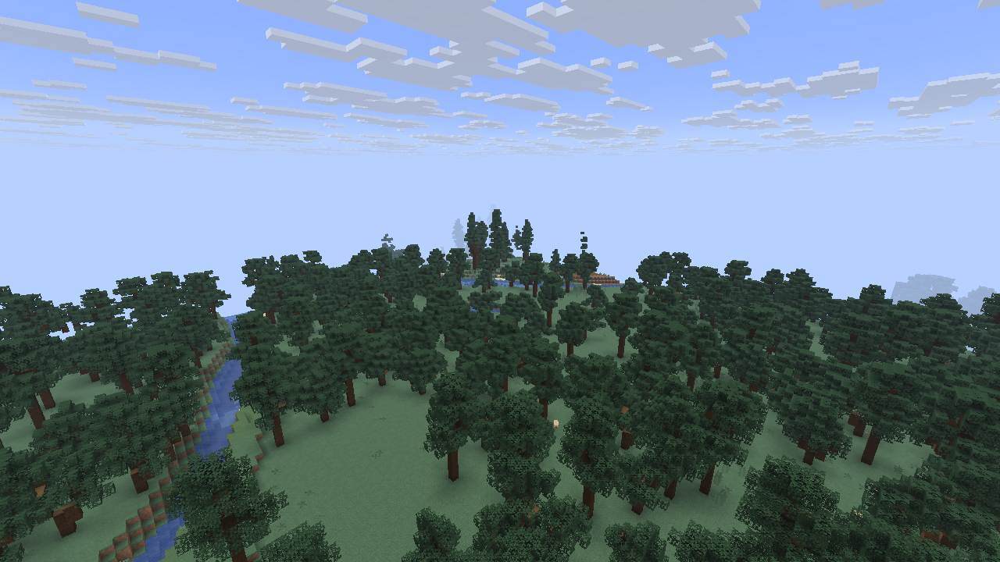

# TerraForged for Minecraft Java 26.2

An independent, unofficial revival of TerraForged for **Fabric and NeoForge**, focused on its terrain, rivers, customization, and use in modern modpacks.

**Development status:** both loaders have passed real packaged client and dedicated-server workflows. The editor creates custom worlds, terrain renders, saves reload, and a normal world can load afterward without inheriting custom settings. The pinned Biomes O' Plenty, GlitchCore and TerraBlender stack also passes its recorded client/server checks. These are experimental candidates; no stable release or complete classic-parity claim is made.

Actual Minecraft capture: Fabric dev9, seed `123456789`. [Scene evidence](docs/validation/client-dev9-scenes.json) records coordinates, terrain fields and verified camera poses. This is target-game evidence, not an original-version visual comparison.

## Use or build a candidate

Use Minecraft Java **26.2** and **Java 25**, with either Fabric Loader **0.20.1** plus Fabric API **0.161.0+26.2**, or NeoForge **26.2.0.93**. Install the matching loader's JAR. [Installation and world-creation instructions](docs/INSTALLATION.md) cover the editor, preset folders, servers and building from source.

The current package snapshots and SHA-256 values are in [the dev11 build record](docs/validation/dual-loader-dev11-build.json). Local Fabric JARs are in `build/libs`; NeoForge JARs are in `neoforge/build/libs`. GitHub's [packaging workflow](.github/workflows/package-candidates.yml) retains experimental artifacts. Only the exact hashes in runtime reports have their recorded game validation.

## Verification

The project tests the actual packaged JARs in disposable non-development installations. Recorded checks cover real preset export, active custom generators, editor/preview events, actual Create New World callbacks, feature-holder consistency, custom-to-vanilla world transitions, saves, reloads, and game-owned screenshots. Larger Fabric checks finish 144 full chunks and compare 576 sampled terrain fields/biomes across request orders. Core mathematical fixtures and cache regressions run separately on Linux and Windows; both loaders also package independently on Ubuntu CI.

[Runtime results](docs/validation/runtime-summary.md) distinguish passing checks, retained failures, and unverified scope. They include corrected cache deadlock, UI rendering/input, lazy-holder race, biome-feature lifecycle, and optional TerraBlender integration defects. Sampled terrain agreement does not establish complete block determinism: vanilla-generator controls also show decoration-order effects.

## Project record

- [Porting plan and completion criteria](docs/PORTING.md)
- [Development log](docs/DEVLOG.md)
- [Feature inventory and known classic gaps](docs/FEATURE-PARITY.md)
- [Regression and acceptance protocol](docs/VALIDATION.md)
- [Upstream audit](docs/research/upstream-audit.md)
- [Target toolchain research](docs/research/target-toolchain.md)
- [GitHub work tracker](https://github.com/TheApple05/TerraForged-26.2/issues)

## Original work and licensing

This is a **new repository, not a GitHub fork**, private during initial development. It is not an official TerraForged release.

- [TerraForged](https://github.com/TerraForged/TerraForged), the original mod and terrain engine.
- [ReTerraForged](https://github.com/racoonman2/ReTerraForged), the subsequent modernization effort.

The implementation baseline is ReTerraForged **1.20.1 / 0.0.6**, commit `29239f1f164d19dbfcccaca4a8277d64e784207c`. Original TerraForged **1.16.5 / 0.2.16**, commit `3ada751ac25cd3eecee5d198870a3abb89734f52`, is the classic reference. [The audit](docs/research/upstream-audit.md) explains why newer experimental/stripped branches were not substituted. Seventeen classic custom biome variants and other inherited gaps remain explicitly inventoried; a complete classic restoration is not implied by the modern port.

Imported code retains attribution and license notices. New history does not imply original authorship of upstream code. See [source provenance](docs/SOURCE-PROVENANCE.json) and [third-party notices](THIRD_PARTY_NOTICES.md). The root license is MIT, with the retained LGPL-2.1-only language-provider component and its license text included in both packages.
